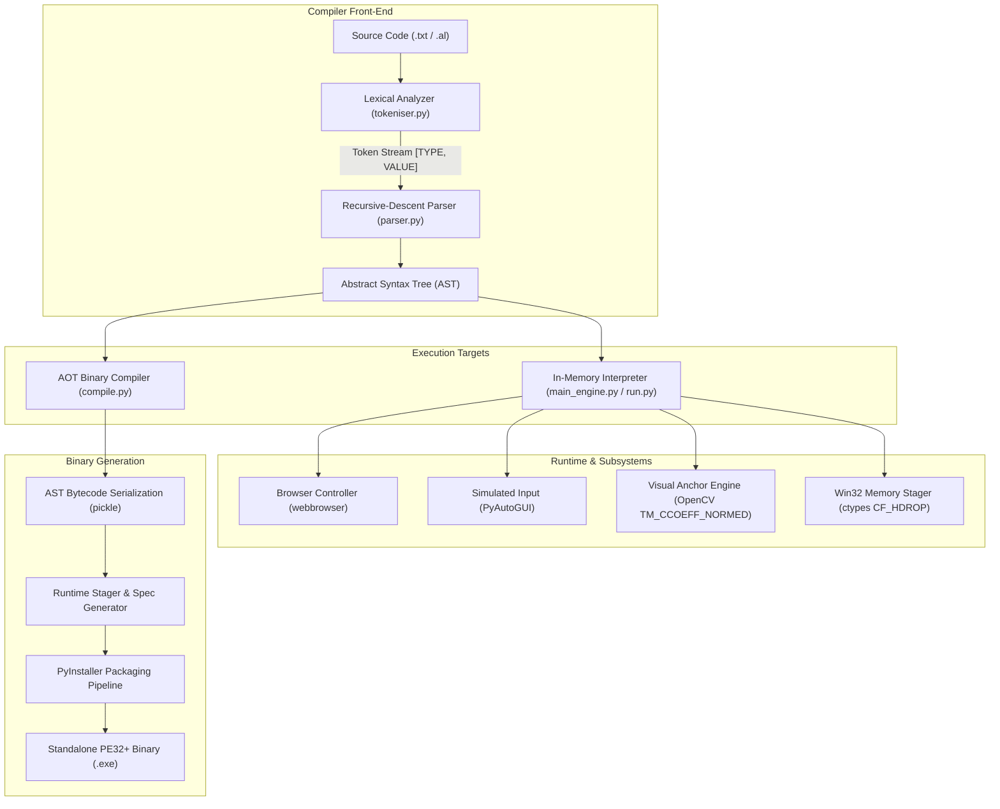

# AutoLang: Lightweight Automation DSL & Compiler

[](https://www.python.org/)
[](https://opensource.org/licenses/MIT)
[](https://microsoft.com/windows)
[](https://opencv.org/)
[%20Recursive--Descent-brightgreen.svg)]()
[](https://pyinstaller.org/)

**AutoLang** is a domain-specific language (DSL), custom multi-phase compiler pipeline, runtime engine, and graphical development environment built from scratch for Robotic Process Automation (RPA) and desktop/browser workflows.

It bridges high-level, human-readable automation scripting with low-level operating system interfaces—featuring an **LL(1) recursive-descent parser**, an **Abstract Syntax Tree (AST)** intermediate representation, **OpenCV-powered computer vision** for UI element anchoring, native **64-bit Win32 clipboard memory injection (`CF_HDROP`)**, and an **Ahead-of-Time (AOT) compiler** that bundles automation scripts into standalone, dependency-free Windows executables (`.exe`).

---

## Architecture Overview

AutoLang is architected around classic compiler design principles, splitting front-end syntax analysis from runtime interpretation and binary packaging.



### Compiler Pipeline Stages

1. **Lexical Analysis (`tokeniser.py`):**
   - Strips whitespace, inline comments (`#`), and C-style comments (`//`).
   - Normalizes identifiers into reserved token classes: `COMMAND`, `KEY`, `STRING`, `NUMBER`, `LBRACE`, `RBRACE`, and `NEWLINE`.
   - Handles multi-character tokens, quoted string literals, and case-insensitive keywords.

2. **Syntax Analysis & AST Construction (`parser.py`):**
   - Implements an **LL(1) Recursive-Descent Parser** with single-token lookahead.
   - Validates command signatures, argument arity, and recursive block structures (`LOOP <n> { ... }`).
   - Generates an **Abstract Syntax Tree (AST)** represented as serialized dictionary nodes, eliminating syntax ambiguities for downstream execution.

3. **Runtime Execution Engine (`main_engine.py`):**
   - Tree-walking AST interpreter dispatching OS primitives.
   - **Computer Vision Matching:** Implements normalized cross-correlation (`cv2.matchTemplate`) with an automatic 10-attempt polling loop and confidence thresholds to anchor dynamic UI coordinates without hardcoding screen pixels.
   - **Native Win32 File Staging:** Directly writes `DROPFILES` memory structures into the Windows Clipboard via `ctypes` and `GlobalAlloc`, enabling file attachments in web browsers without touching File Explorer or relying on fragile `Alt+Tab` window switching.

4. **Ahead-of-Time Binary Compilation (`compile.py`):**
   - Serializes the verified AST into bytecode via `pickle`.
   - Injects the serialized AST into an embedded runner stub.
   - Invokes PyInstaller programmatically to generate an isolated, single-file Windows executable (`.exe`) that executes on target machines without requiring Python or external dependencies.

5. **Integrated Development Environment (`gui.py`):**
   - Native Tkinter GUI featuring a script editor, live console output redirector, execution controls, and a one-click "Compile to EXE" export dialog.
   - Runs automation tasks in a non-blocking background thread (`threading.Thread`) with active UI responsiveness and screen-corner failsafe detection (`(0, 0)` abort).

---

## DSL Command Specification

AutoLang uses an intuitive, line-oriented command grammar designed for rapid authoring of complex desktop workflows:

| Command | Arguments | Description | Example |
| :--- | :--- | :--- | :--- |
| `OPEN` | `"<url>"` | Launches default system browser to specified URL | `OPEN "https://mail.google.com"` |
| `GAP` / `SLEEP`| `<seconds>` | Pauses script execution | `GAP 3` |
| `PRESS` | `<KEY> [count]` | Presses a keyboard key $N$ times | `PRESS TAB 4`<br>`PRESS ENTER` |
| `TYPE` | `"<text>"` | Types string literal with natural keystroke interval | `TYPE "Quarterly Report Attached"` |
| `HOTKEY` | `<KEY> <KEY>...`| Fires simultaneous key combination | `HOTKEY CTRL A` |
| `CLICK` | `[LEFT\|RIGHT]` | Simulates mouse click (defaults to left click) | `CLICK`<br>`CLICK RIGHT` |
| `SCROLL` | `UP\|DOWN [amount]` | Scrolls active window vertically | `SCROLL DOWN 5` |
| `FIND` | `"<image_path>"`| Uses OpenCV visual template matching to locate image on screen and moves mouse cursor to center | `FIND "assets/attach_icon.png"` |
| `TYPEFILE` | `"<file_path>"` | Reads text file and types each line separated by Enter | `TYPEFILE "recipients.txt"` |
| `COPYFILES`| `"<folder>" ["exclude"]` | Encodes directory files into Windows `CF_HDROP` clipboard format for direct pasting into file dialogs | `COPYFILES "D:\Materials" "notes.txt"` |
| `LOOP` | `<count> { ... }`| Executes nested command block $N$ times | `LOOP 3 { PRESS TAB GAP 1 }` |
| `SCREENSHOT`| `["<filename>"]`| Captures full display screenshot to file | `SCREENSHOT "result.png"` |
| `ALERT` | `"<message>"` | Displays OS modal dialog with message | `ALERT "Workflow completed!"` |
| `WAIT` | *(none)* | Pauses execution until Enter is pressed in console | `WAIT` |

### Supported Key Identifiers
* **Control Keys:** `TAB`, `ENTER`, `SPACE`, `BACKSPACE`, `DELETE`, `ESC`, `WIN`, `CTRL`, `ALT`, `SHIFT`
* **Navigation:** `UP`, `DOWN`, `LEFT`, `RIGHT`, `HOME`, `END`, `PAGEUP`, `PAGEDOWN`
* **Function Keys:** `F1` through `F12`
* **Alphanumerics:** `A` – `Z`

---

## Production Example: Automated Email Dispatcher

The included `automation.txt` demonstrates an end-to-end automated email pipeline:

```autolang
# 1. Open Gmail Compose directly
OPEN "https://mail.google.com/mail/u/0/#inbox?compose=new"
GAP 15

# 2. Populate recipients from external text file
TYPEFILE "D:\MATERIALS\emails.txt"
GAP 1

# 3. Navigate to Subject and Body fields
PRESS TAB
PRESS TAB
TYPE "Hello, please find all the documents attached below."
GAP 1

# 4. Locate Attachment icon visually using OpenCV template matching
FIND "C:\assets\attach_button.png"
GAP 1
CLICK

# 5. Navigate file dialog and select target folder
FIND "C:\assets\address_bar.png"
GAP 1
CLICK
TYPE "D:\File_auto"
PRESS ENTER
GAP 1

# 6. Select all items and stage into dialog
PRESS TAB 4
HOTKEY CTRL A
PRESS ENTER
GAP 10

# 7. Locate Send button and trigger dispatch
FIND "C:\assets\send_button.png"
CLICK
ALERT "Email sent successfully"
```

---

## Technical Highlights & Engineering Solutions

### 1. 64-bit Pointer Truncation Resolution (`ctypes`)
When allocating global heap memory for clipboard structures (`GlobalAlloc` and `GlobalLock`), standard 64-bit Windows pointers exceed 32-bit integer address spaces (> 4 GB boundary). Default Python `ctypes` handles them as 32-bit `c_int`, causing address truncation to `0x0000000000000000` (NULL pointer) and triggering access violation crashes during `memmove`. 

AutoLang explicitly binds 64-bit foreign function interfaces:
```python
kernel32.GlobalAlloc.argtypes = [ctypes.c_uint, ctypes.c_size_t]
kernel32.GlobalAlloc.restype = ctypes.c_void_p
kernel32.GlobalLock.argtypes = [ctypes.c_void_p]
kernel32.GlobalLock.restype = ctypes.c_void_p
```

### 2. Focus Inversion Elimination via `CF_HDROP`
Traditional automation scripts rely on launching File Explorer, selecting files, and pressing `Alt + Tab` to switch back to the target application. This approach frequently fails due to asynchronous window z-ordering and focus-stealing by background notifications.

AutoLang eliminates this vulnerability entirely through the `COPYFILES` command. It constructs an in-memory `DROPFILES` struct containing double-null-terminated UTF-16LE paths and injects them directly into the Windows clipboard subsystem (`CF_HDROP = 15`). Files are staged instantaneously in the background without opening File Explorer or touching `Alt + Tab`.

### 3. Non-Blocking Multithreaded IDE Architecture
In `gui.py`, long-running scripts execute on a dedicated background worker (`threading.Thread`). Keystroke timing and sleep intervals do not freeze the Tkinter event loop. Standard output (`stdout`) and standard error (`stderr`) are piped via a custom queue to the UI console in real time.

---

## Getting Started

### Prerequisites
* **Operating System:** Windows 10 or Windows 11 (64-bit)
* **Python Version:** Python 3.10 or higher
* **C++ Build Tools:** Required for standard dependencies (optional if wheels available)

### Installation

1. **Clone the repository:**
   ```bash
   git clone https://github.com/shyam-shankar/AutoLang-Lightweight-automation-DSL.git
   cd AutoLang-Lightweight-automation-DSL
   ```

2. **Create and activate a virtual environment:**
   ```powershell
   python -m venv venv
   .\venv\Scripts\Activate.ps1
   ```

3. **Install dependencies:**
   ```bash
   pip install -r requirements.txt
   ```

---

## Usage

### 1. Launching the Visual IDE
```bash
python gui.py
```
* **Editor:** Write or paste AutoLang scripts with full multi-line editing.
* **Run Button:** Executes script in memory with live console feedback.
* **Compile to EXE Button:** Prompts for target destination and compiles the active script into a standalone `.exe`.
* **Emergency Abort:** Slam the mouse cursor to any corner of the screen (e.g., top-left `(0, 0)`) to trigger PyAutoGUI's failsafe abort.

### 2. CLI In-Memory Interpreter
To execute an AutoLang script directly from PowerShell or Command Prompt:
```bash
python run.py automation.txt
```

### 3. Ahead-of-Time Binary Compiler
To compile an AutoLang script into a standalone executable:
```bash
python compile.py automation.txt -o my_automation.exe
```
The resulting `.exe` can be distributed and executed on any compatible 64-bit Windows machine without requiring Python.

---

## Project Structure

```
AutoLang-Lightweight-automation-DSL/
├── tokeniser.py         # Lexical analyzer / Scanner (regex-based tokenizer)
├── parser.py            # LL(1) recursive-descent parser (AST builder)
├── main_engine.py       # Runtime AST interpreter, OpenCV matching, Win32 memory stager
├── compile.py           # AOT binary compiler & PyInstaller packaging pipeline
├── run.py               # CLI runner for in-memory script execution
├── gui.py               # Tkinter IDE with editor, live console, and compiler UI
├── automation.txt       # Production example script (Gmail automation)
├── requirements.txt     # Python package dependencies
├── .gitignore           # Git ignore rules for build artifacts, venv, and caches
├── LICENSE              # MIT Open-Source License
└── README.md            # Comprehensive project documentation
```

---

## License

This project is licensed under the [MIT License](LICENSE) - see the LICENSE file for details.

Developed by **Shyam Shankar**  
GitHub: [@shyam-shankar](https://github.com/shyam-shankar)
